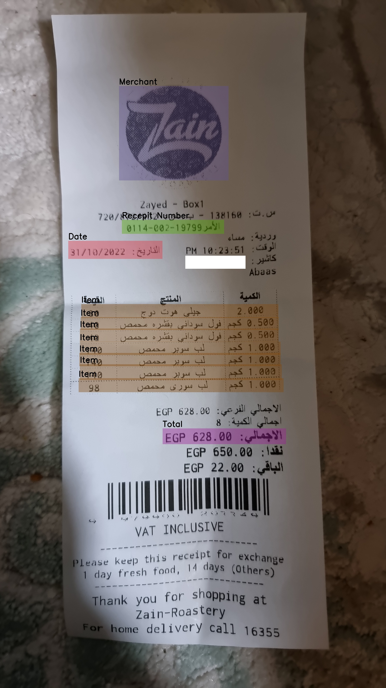
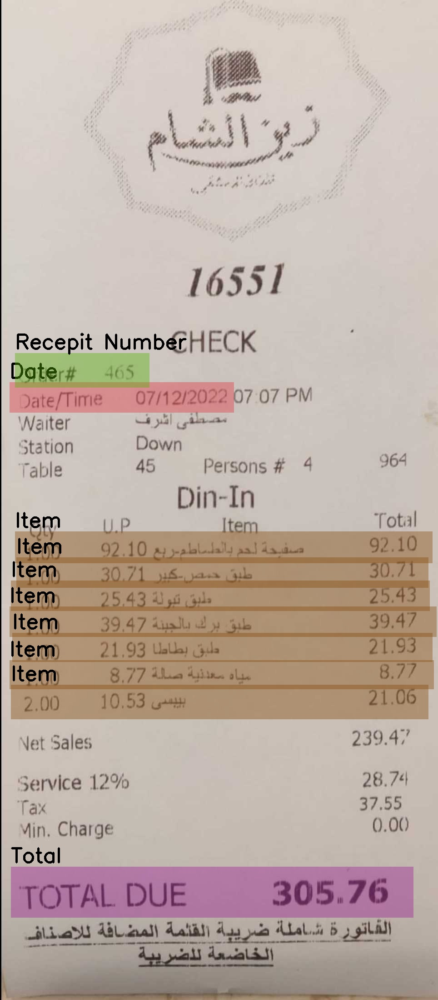
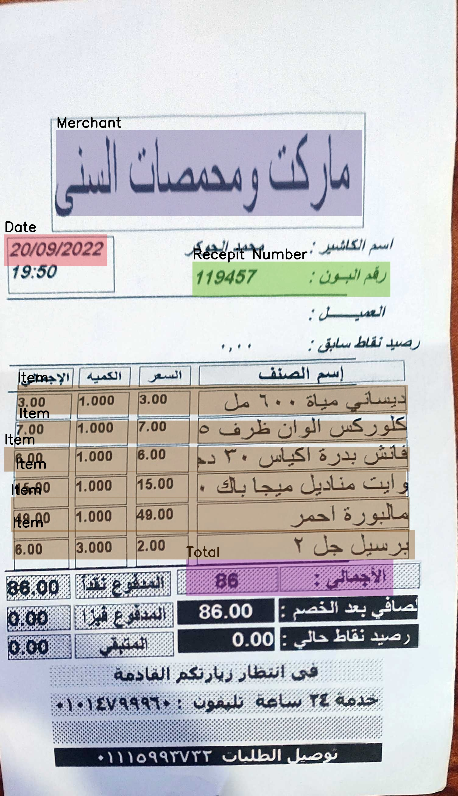
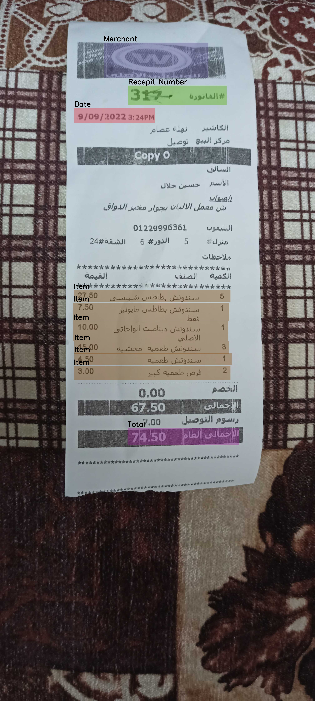
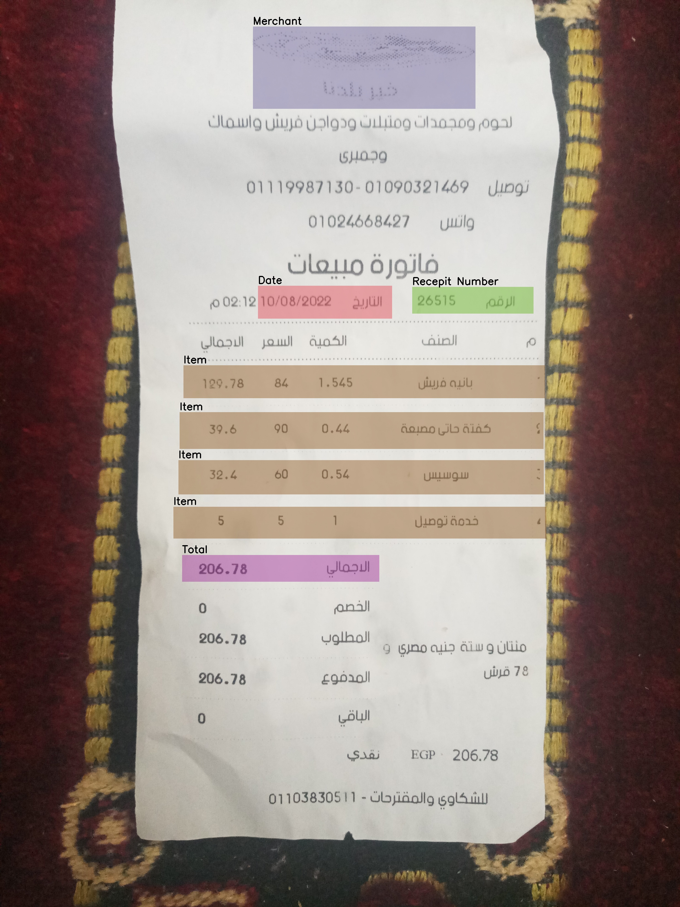

# ReceiptSense: Beyond Traditional OCR - A Dataset for Receipt Understanding

[](https://arxiv.org/abs/2406.04493)
[](https://huggingface.co/datasets/abdoelsayed/CORU)
## 🔥 News
- **[2024]** ReceiptSense dataset is now publicly available!

## 📖 Abstract

Multilingual OCR and information extraction from receipts remains challenging, particularly for complex scripts like Arabic. We introduce **ReceiptSense**, a comprehensive dataset designed for Arabic-English receipt understanding comprising:

- **20,000** annotated receipts from diverse retail settings
- **30,000** OCR-annotated images  
- **10,000** item-level annotations
- **1,265** receipt images with **40 question-answer pairs each** for Receipt QA

The dataset captures merchant names, item descriptions, prices, receipt numbers, and dates to support object detection, OCR, information extraction, and question-answering tasks. We establish baseline performance using traditional methods (Tesseract OCR) and advanced neural networks, demonstrating the dataset's effectiveness for processing complex, noisy real-world receipt layouts.

## 🎯 Key Features

### ✨ **Multilingual Support**
- **Arabic-English** bilingual receipts
- Real-world mixed-language content
- Complex script handling for Arabic text

### 📊 **Comprehensive Annotations**
- **Object Detection**: Bounding boxes for key receipt elements
- **OCR**: Character and word-level text recognition
- **Information Extraction**: Structured data extraction
- **Receipt QA**: Question-answering capabilities

### 🏪 **Diverse Retail Environments**
- Supermarkets and grocery stores
- Restaurants and cafes
- Clothing and retail shops
- Various geographical regions

### 🔧 **Real-world Challenges**
- Noisy and degraded image quality
- Complex receipt layouts
- Mixed fonts and orientations
- Authentic retail scenarios

## 📈 Dataset Statistics

| Component | Training | Validation | Test | Total |
|-----------|----------|------------|------|-------|
| **Key Information Detection** | 12,600 | 3,700 | 3,700 | **20,000** |
| **OCR Dataset** | 21,000 | 4,500 | 4,500 | **30,000** |
| **Item Information Extraction** | 7,000 | 1,500 | 1,500 | **10,000** |
| **Receipt QA** | - | - | 1,265 | **1,265** |

### Language Distribution
- **Arabic**: 53.6%
- **English**: 26.2%  
- **Mixed Language**: 20.3%

### Receipt QA Coverage
- **Merchant/Payment/Date Metadata**: 30%
- **Item-level Information**: 50%
- **Tax/Total/Payment Details**: 20%

## 🖼️ Sample Images

<div align="center">

| Sample 1 | Sample 2 | Sample 3 | Sample 4 | Sample 5 |
|----------|----------|----------|----------|----------|
|  |  |  |  |  |

*Examples of annotated receipt images showcasing the variety of formats, languages, and complex text layouts*

</div>

## 🎯 Supported Tasks

### 1. 🎯 **Key Information Detection**
Extract essential receipt information including:
- Merchant names
- Transaction dates  
- Receipt numbers
- Item lists and descriptions
- Total amounts

### 2. 🔍 **OCR (Optical Character Recognition)**
Box-level text annotations for:
- Multilingual text recognition
- Complex layout understanding
- Noisy image processing

### 3. 📝 **Information Extraction**
Detailed item-level analysis:
- Item names and descriptions
- Prices and quantities
- Categories and classifications
- Brands and packaging information

### 4. ❓ **Receipt Question Answering**
Comprehensive QA capabilities covering:
- Receipt metadata queries
- Item-specific questions
- Transaction summary questions
- Payment and tax information

## 📥 Download Links

### 🎯 Key Information Detection
- **Training Set**: [Download (12.6K images)](https://huggingface.co/datasets/abdoelsayed/CORU/resolve/main/Receipt/train.zip?download=true)
- **Validation Set**: [Download (3.7K images)](https://huggingface.co/datasets/abdoelsayed/CORU/resolve/main/Receipt/val.zip?download=true)
- **Test Set**: [Download (3.7K images)](https://huggingface.co/datasets/abdoelsayed/CORU/resolve/main/Receipt/test.zip?download=true)

### 🔍 OCR Dataset
- **Training Set**: [Download (21K images)](https://huggingface.co/datasets/abdoelsayed/CORU/resolve/main/OCR/train.zip?download=true)
- **Validation Set**: [Download (4.5K images)](https://huggingface.co/datasets/abdoelsayed/CORU/resolve/main/OCR/val.zip?download=true)
- **Test Set**: [Download (4.5K images)](https://huggingface.co/datasets/abdoelsayed/CORU/resolve/main/OCR/test.zip?download=true)

### 📝 Item Information Extraction
- **Training Set**: [Download (7K items)](https://huggingface.co/datasets/abdoelsayed/CORU/resolve/main/IE/train.csv?download=true)
- **Validation Set**: [Download (1.5K items)](https://huggingface.co/datasets/abdoelsayed/CORU/resolve/main/IE/val.csv?download=true)
- **Test Set**: [Download (1.5K items)](https://huggingface.co/datasets/abdoelsayed/CORU/resolve/main/IE/test.csv?download=true)

### ❓ Receipt Question Answering
- **Test Set**: [Download (1,265 receipts with 50.6K QA pairs)](https://huggingface.co/datasets/abdoelsayed/CORU/resolve/main/QA/test.zip?download=true)

> ⚠️ **Note**: All receipt datasets have been updated to include PII-redacted versions for privacy protection.

## 🏆 Baseline Results

### Object Detection Performance
| Model | Backbone | Precision | Recall | mAP50 | mAP50-95 |
|-------|----------|-----------|--------|-------|----------|
| **YOLOv7** | - | **76.0%** | **85.6%** | **79.2%** | 43.7% |
| YOLOv8 | - | 74.6% | 81.0% | 76.1% | 45.3% |
| YOLOv9 | - | 75.7% | 83.4% | 77.9% | **46.7%** |
| DINO | Swin-T | - | - | - | **32.2%** (Avg IoU) |

### OCR Performance
| Model | CER ↓ | WER ↓ |
|-------|-------|-------|
| Tesseract | 15.56% | 30.78% |
| Attention-Gated CNN-BiGRU | 14.85% | 27.22% |
| Our OCR Model | 7.83% | 27.24% |
| **Azura OCR** | **6.39%** | **25.97%** |

### Receipt QA Performance
| Model | Precision | Recall | Exact Match | Contains |
|-------|-----------|--------|-------------|----------|
| **GPT-4o** | **37.7%** | **36.4%** | **35.0%** | **29.1%** |
| Llama3.2 (11B) | 32.6% | 31.3% | 31.6% | 25.9% |
| Phi3.5 | 28.4% | 29.1% | 28.8% | 23.7% |
| Internvl2 (8B) | 24.2% | 23.8% | 23.1% | 19.4% |

## 🚀 Getting Started

### Quick Start
```python
# Install required packages
pip install datasets transformers torch

# Load the dataset
from datasets import load_dataset

# Load Receipt QA dataset
qa_dataset = load_dataset("abdoelsayed/CORU", "qa")

# Load OCR dataset  
ocr_dataset = load_dataset("abdoelsayed/CORU", "ocr")

# Load Information Extraction dataset
ie_dataset = load_dataset("abdoelsayed/CORU", "ie")
```

### Dataset Structure
```
ReceiptSense/
├── Receipt/          # Key Information Detection
│   ├── images/       # Receipt images
│   └── annotations/  # YOLO/COCO format annotations
├── OCR/             # OCR Dataset
│   ├── images/      # Text line images
│   └── labels/      # Character annotations
├── IE/              # Information Extraction
│   └── data.csv     # Structured item data
└── QA/              # Receipt Question Answering
    ├── images/      # Receipt images
    └── qa_pairs.json # Question-answer pairs
```

## 🔬 Applications

- **💳 Expense Management**: Automated expense tracking and categorization
- **📦 Inventory Management**: Real-time inventory updates from receipt data  
- **🏪 Retail Analytics**: Customer behavior and purchasing pattern analysis
- **🤖 Document AI**: Multilingual document understanding systems
- **📱 Mobile Apps**: Receipt scanning and digitization applications

## 🤝 Comparison with Existing Datasets

| Dataset | Images | Categories | Languages | Item IE | Receipt QA | Year |
|---------|--------|------------|-----------|---------|------------|------|
| SROIE | 1,000 | 4 | English | ✓ | ✗ | 2019 |
| CORD | 1,000 | 8 | English | ✓ | ✗ | 2019 |
| MC-OCR | 2,436 | 4 | EN + Vietnamese | ✓ | ✗ | 2021 |
| UIT | 2,147 | 4 | EN + Vietnamese | ✓ | ✗ | 2022 |
| **ReceiptSense** | **20,000** | **5** | **Arabic + English** | **✓** | **✓** | **2024** |

## 🏛️ Ethics and Privacy

- All receipts collected with explicit user consent through the DISCO application
- Comprehensive 4-step PII redaction process implemented
- Privacy protocols strictly followed during data collection
- Independent verification and cross-checking procedures


## 📚 Citation

If you find ReceiptSense useful for your research, please consider citing our paper:

```bibtex
soon
```


## 🔗 Links

- 📄 **Paper**: [arXiv:2406.04493](https://arxiv.org/abs/2406.04493)
- 🤗 **HuggingFace**: [abdoelsayed/CORU](https://huggingface.co/datasets/abdoelsayed/CORU)
- 💼 **DISCO App**: [https://discoapp.ai/](https://discoapp.ai/)
- 📧 **Contact**: [abdelrahman.abdallah@uibk.ac.at](mailto:abdelrahman.abdallah@uibk.ac.at)

---

<div align="center">

**🌟 Star this repository if you find it helpful! 🌟**


</div>
